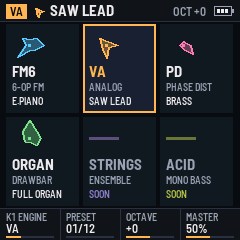
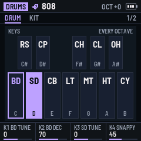
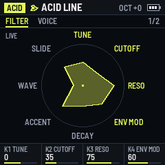

# KLASSIK – klassische Synth-Klänge für den M-VAVE FM-1

Eine eigene Firmware für den M-VAVE FM-1: mehrere klassische Synth-Engines in einem „Rack“, mit einer
übersichtlichen Oberfläche, in der jeder Sound ein eigenes Symbol hat (seine **Glyphe**: die acht Parameter des
Sounds als acht Strahlen).

**Status: v0.6 (Step-Sequencer, Effekte Delay und Hall), experimentell.** Getestet nur im Host-Simulator und im
Browser-Emulator, noch nicht auf einem FM-1.

## Was es kann (Stand v0.6)

- Sechs Parts gleichzeitig (am Anfang jede Engine einmal), jeder mit eigener Engine, eigenem Sound und eigener
  Oktave; SEL wählt den Part, MIDI-Kanal 1–6 spielt Part 1–6.
- Mixer (GLO): je Part Pegel, Pan, Mute, Solo und die Sends an Delay und Hall (Tab SEND); Ausgang stereo mit Limiter.
- Effekte (FX): ein Ping-Pong-Delay im Takt des Loopers (bis 0,5 s je Seite) und der Hall von
  [Rings](https://github.com/pichenettes/eurorack) (MIT, nach C portiert) mit Vorverzögerung.
- Noten-Looper (SEQ, PLAY, REC): eine Schleife für alle sechs Parts, Overdub, die erste Aufnahme legt die Länge fest,
  Vorzähler und Klick, QUANT, eine Stufe Rückgängig je Part (HOME + REC); die Kopfzeile zeigt Takt und Schlag.
- Step-Sequencer (Tab STEP der Looper-Seite): 16 Steps je Takt auf denselben Noten, die weißen Tasten als Steps mit
  Lauflicht, DRUMS je Instrument wie bei einer TR; Note, Anschlag und Länge je Step.
- Sechs Engines, sechs Stimmen je Part:
  - **FM6**: sechs Operatoren wie ein DX7, 32 Algorithmen, auf dem FM-Kern
    [msfa](https://github.com/google/music-synthesizer-for-android) (Apache-2.0, nach C portiert); acht eigene
    Presets (keine DX7-Werksklänge).
  - Drei aus [Felucca-Engines](https://github.com/hugelton/Felucca-Engines) (MIT): **VA** (ANALOG),
    **PD** (PHASE, Phase Distortion), **ORGAN** (WHEEL, Zugriegel-Orgel).
  - **DRUMS**: vier Kits im Stil von TR-606, TR-707, TR-808 und TR-909, zwölf Instrumente je Kit, eins je Taste
    einer Oktave; berechnet auf den Drum-Modellen von [Plaits](https://github.com/pichenettes/eurorack) (MIT, nach
    C portiert) und eigenen (Toms, Clap, Rimshot, Cowbell), keine Samples aus den Geräten.
  - **ACID**: ein einstimmiger Bass im Stil der TB-303 mit Slide (gebunden gespielt) und Accent (ENV gehalten), auf
    [Open303](https://github.com/RobinSchmidt/Open303) von Robin Schmidt (MIT, nach C portiert); acht eigene Presets.
- Rack-Bildschirm mit Glyphen, Kopfzeile, Reglerzeile.
- Edit-Seiten: EDIT öffnet je Engine zwei Seiten mit je vier Parametern auf K1–K4. Die Glyphe in der Kopfzeile
  und eine große Live-Glyphe verformen sich beim Drehen, der Klang ändert sich sofort. HOME halten und einen Regler
  drehen setzt ihn auf den Wert seines Sounds zurück.
- Eigener Sound: SAVE speichert einen geänderten Sound als USER-Sound seiner Engine (einer je Engine).
- Tasten mit Anschlagdynamik, MIDI-In (USB, TRS), MIDI-Out (USB), Oktave, Speichern über den Neustart hinaus,
  Screenreader-Ansagen (fm1-reader).

Bedienung: [firmware/klassik/docs/MANUAL.md](firmware/klassik/docs/MANUAL.md). Konzept und Fahrplan:
[docs/CONCEPT.md](docs/CONCEPT.md).

## Aufbau

| Pfad | Was |
| --- | --- |
| `base/` | [fm1-base](https://github.com/charlesvestal/fm1-base) (Git-Submodul, MPL-2.0): Plattform, Host-Simulator, Browser-Emulator, Build-Werkzeuge |
| `engines/` | [Felucca-Engines](https://github.com/hugelton/Felucca-Engines) (Git-Submodul, MIT) |
| `firmware/klassik/app.c` | die App: Bildschirm, Bedienung, Einstellungen, Audio-Ausgabe |
| `firmware/klassik/dsp/engines.c` | der Stimmen-Host für die Engines (MIT, nach `engines/tests/fe_host.c`) |
| `firmware/klassik/dsp/eng_fm6.c` | FM6: die acht Parameter und die Presets |
| `firmware/klassik/dsp/fm6/` | msfa, nach C portiert (Apache-2.0, Lizenztext in `LICENSE`) |
| `firmware/klassik/tools/gen_fm6_tables.py` | rechnet msfas Tabellen beim Build (Apache-2.0) |
| `firmware/klassik/dsp/eng_drums.c` | DRUMS: die Kits, die Tastenbelegung, Toms, Clap, Rimshot und Cowbell |
| `firmware/klassik/dsp/drums/` | die Drum-Modelle von Plaits, nach C portiert (MIT) |
| `firmware/klassik/dsp/eng_acid.c` | ACID: die acht Parameter und die Presets |
| `firmware/klassik/dsp/acid/` | Open303, nach C portiert (MIT) |
| `firmware/klassik/tools/gen_acid_tables.py` | rechnet die Wellenform-Tabellen und Filter-Koeffizienten von Open303 beim Build (MIT) |
| `firmware/klassik/dsp/fx.c` | die Effekte: Ping-Pong-Delay, Vorverzögerung des Halls |
| `firmware/klassik/dsp/hall/` | der Hall von Rings, nach C portiert (MIT) |
| `firmware/klassik/fm1.toml` | Build-Einstellungen |
| `firmware/klassik/tests/*.txt` | Tests für den Host-Simulator (mit Screenshots und WAV) |
| `tools/setup.sh` | holt die Submodule in den getesteten Versionen |

## Erste Schritte (Mac)

Voraussetzungen: Git, ein C-Compiler (`xcode-select --install`), [Homebrew](https://brew.sh), Python 3.

1. FriBiDi installieren. Der Build rendert die Schriften mit Pillow (`base/tools/gen_font.py`); Pillow nutzt dafür
   libraqm, und libraqm lädt FriBiDi zur Laufzeit:

       brew install fribidi

2. Eine Python-Umgebung mit Pillow im Repository anlegen (`.venv/` steht in `.gitignore`):

       python3 -m venv .venv
       .venv/bin/pip install Pillow

3. Prüfen, ob Pillow FriBiDi findet. Erwartet: `True` und eine Versionsnummer, z. B. `True 1.0.17`:

       .venv/bin/python -c "from PIL import features; print(features.check('raqm'), features.version('fribidi'))"

   Steht dort `False`, findet macOS die Bibliotheken von Homebrew nicht von selbst. Dann vor dem Build (oder
   dauerhaft in `~/.zshrc`):

       export DYLD_FALLBACK_LIBRARY_PATH="$(brew --prefix)/lib"

4. Submodule holen, den Host-Simulator bauen, alle Tests laufen lassen (jede Zeile „ok“):

       sh tools/setup.sh
       .venv/bin/python base/tools/build.py firmware/klassik --host
       for t in firmware/klassik/tests/*.txt; do firmware/klassik/build/host/klassik_host "$t" firmware/klassik/build/host || break; done

Die Screenshots (u. a. `boot.png`, `edit-va-1.png`, `fm6.png`, `fm6-edit-1.png`, `drums.png`, `drums-edit-1.png`,
`acid.png`, `acid-edit-1.png`) und die WAVs (`va.wav`; `edit-cut.wav`, ein Filter-Sweep beim Drehen; `fm6-*.wav`,
je FM6-Preset ein Akkord; `drums-606.wav` … `drums-909.wav`, je Kit ein Takt; `acid-line.wav`, eine Basslinie mit
Slides und Accents) liegen danach in `firmware/klassik/build/host/`.

Im Browser (braucht Emscripten, z. B. `brew install emscripten`):

    .venv/bin/python base/tools/build.py firmware/klassik --web      # firmware/klassik/build/emu/

Für den FM-1 selbst (braucht Docker Desktop und die JieLi-Toolchain, siehe `base/README.md`):

    .venv/bin/python base/tools/build.py firmware/klassik            # firmware/klassik/build/klassik.fwsc

Der Geräte-Build ist noch **nicht** getestet. Vor dem ersten Flashen: Backup, und die Community-Regel beachten,
vor einem Wechsel zwischen Custom-Firmwares erst auf die Stock-Firmware V15 zurückzugehen.

## Lizenz

Eigene Dateien: MPL-2.0 (`LICENSE`), Details zu allen Teilen in [LICENSING.md](LICENSING.md).
