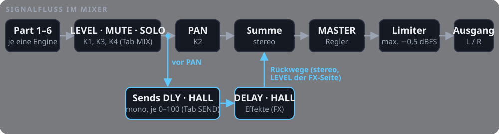

# KLASSIK – Handbuch (v1.0)

## Parts
<!-- chapter: Grundlagen | parts | va -->

Sechs Parts klingen gleichzeitig, jeder mit eigener Engine, eigenem Sound und eigener Oktave.

### Auf einen Blick

- **Wählen:** SEL: der nächste Part (1 … 6, dann wieder 1); SELECT: nach rechts der nächste, nach links der vorige
- **Am Anfang:** Part 1 VA, 2 DRUMS, 3 ACID, 4 FM6, 5 PD, 6 ORGAN
- **Gehört dem gewählten:** Tasten, K1, PRESET, OCT− / OCT+ und EDIT, auf jeder Seite
- **MIDI:** Kanal 1–6 spielt Part 1–6, die anderen Kanäle den gewählten Part; die Tasten senden auf dem Kanal ihres Parts

### Grundlagen

- **Ein Part:** Engine, Sound und Oktave, dazu sein Kanalzug im Mixer, sein LFO, sein Arp und seine Spur im Looper
- **Je Engine ein Gedächtnis:** Jeder Part merkt sich je Engine seinen Sound und seine Änderungen
- **Gleiche Engine:** Zwei Parts können dieselbe Engine mit verschiedenen Sounds spielen
- **Gehaltene Taste:** Sie klingt beim Wechsel auf ihrem Part weiter, bis sie losgelassen wird

<!-- scene: parts-select -->

### Anzeige

- **Kopfzeile:** Der gewählte Part und seine Engine (`1 VA`)
- **Rack:** Auf jeder Kachel die Parts, die diese Engine spielen; der gewählte gefüllt, die anderen umrandet

### Rechenzeit

- **Obergrenze:** Alle Parts zusammen haben eine Obergrenze an Rechenzeit; wird sie überschritten, endet die älteste Stimme, zuerst eine schon losgelassene
- **Kosten:** Eine ACID-Stimme kostet so viel wie gut sieben FM6-Stimmen
- **Geschätzt:** Die Grenze ist geschätzt und wird mit einem Gerät eingemessen

## Rack
<!-- chapter: Grundlagen | rack | va -->

Die Startseite: sechs Kacheln, je Engine eine, und was die Bedienelemente dort tun.

### Auf einen Blick

- **Kacheln:** VA, DRUMS, ACID, FM6, PD, ORGAN, von links oben nach rechts unten; je Kachel Glyphe, Engine und Sound
- **Fußzeile:** K1 ENGINE, PRESET, OCTAVE, MASTER
- **Ungespeichert:** SAVE leuchtet, solange etwas nicht gespeichert ist
- **MIDI-In:** über USB und TRS spielt ebenfalls

### Bedienelemente

| Bedienelement | Was es tut |
| --- | --- |
| Tasten | spielen den gewählten Part (Anschlagdynamik; ACID: Accent mit ENV), senden die Noten über USB-MIDI |
| SEL, SELECT | nächster Part (SELECT nach links: voriger) |
| K1 | Engine des Parts wählen, in der Reihenfolge des Racks: VA (ANALOG), DRUMS, ACID, FM6, PD (PHASE), ORGAN (WHEEL) |
| PRESET | Sound der Engine wählen; nach den Presets folgt USER, sobald die Engine einen eigenen Sound hat |
| OCT−, OCT+ | Oktave des Parts −2 … +2 |
| EDIT | Edit-Seiten der Engine öffnen |
| GLO | Mixer und Sounds öffnen (dort geht GLO durch MIX, SEND und LIST, OCT− schließt) |
| FX | Effekt-Seite öffnen (dort wechselt FX zwischen DELAY und HALL, OCT− schließt sie) |
| SEQ | Looper-Seite öffnen (dort wechselt SEQ zwischen LOOP und STEP, OCT− schließt sie) |
| LFO, ARP | Seite des LFO bzw. des Arpeggiators des gewählten Parts öffnen |
| PLAY, REC | Looper starten und stoppen, aufnehmen (auf jeder Seite, siehe Looper) |
| HOME + REC, HOME + PLAY | letzte Aufnahme des gewählten Parts zurücknehmen, Part leeren (siehe Looper) |
| ENV | bei ACID: gehalten, sind die angeschlagenen Noten akzentuiert (`ACC` in der Kopfzeile); sonst die Hüllkurve öffnen |
| SAVE | speichern: den gewählten Part, je Part Engine, Sounds und Oktave, Mixer und Effekte |
| MASTER | Lautstärke |

<!-- scene: rack-sound -->

## Mixer
<!-- chapter: Mischen & Effekte | mixer | fm6 -->

Die sechs Parts zusammenführen: Lautstärke, Panorama, Mute und Solo, Sends an Delay und Hall.

### Auf einen Blick

- **Öffnen:** GLO (leuchtet); GLO oder OCT+ geht weiter: MIX → SEND → LIST → MIX
- **Schließen:** OCT−; EDIT, SEQ und FX wechseln direkt zu ihren Seiten
- **Drei Parts je Seite:** 1–3 oder 4–6, dazu MASTER; die Seite folgt dem gewählten Part (SEL, SELECT)
- **Gewählter Part:** Sein Zug ist umrandet, K1–K4 stellen ihn ein; die Tasten spielen weiter
- **Speichern:** SAVE speichert den Mixer mit

### Grundlagen

- **Kanalzug:** Jeder Part hat einen: LEVEL (Lautstärke), PAN (Platz im Stereobild), MUTE (stumm), SOLO (nur dieser)
- **Sends:** Sie schicken einen Teil des Signals an Delay und Hall; die Rückwege bringen den Effekt in die Summe
- **Am Ende:** MASTER regelt die Gesamtlautstärke, der Limiter fängt Spitzen ab

<!-- scene: mixer-open -->

### Tab MIX

| Regler | Was er tut |
| --- | --- |
| K1 LEVEL | Pegel des Parts, −40 … +6 dB in 1-dB-Schritten, darunter aus (OFF); am Anfang 0 dB |
| K2 PAN | links (L50) … Mitte (C) … rechts (R50): die ferne Seite wird leiser, die nahe bleibt; in der Mitte beide voll |
| K3 MUTE | nach rechts an, nach links aus |
| K4 SOLO | nach rechts an, nach links aus; ist ein Part auf Solo, sind alle anderen stumm (außer weiteren Solo-Parts) |
| HOME + K1–K4 | zurück auf 0 dB, Mitte, aus; steht LEVEL oder PAN woanders, zeigt eine helle Marke im Balken, wo 0 dB bzw. die Mitte ist |

<!-- scene: mixer-level -->

<!-- scene: mixer-mute -->

### Tab SEND

| Regler | Was er tut |
| --- | --- |
| K1 DELAY | wie viel der Part ans Delay schickt, 0–100; am Anfang 0 |
| K2 HALL | wie viel er an den Hall schickt, 0–100; am Anfang 0 |
| K3, K4 | frei (später für weitere Effekte) |
| HOME + K1, K2 | zurück auf 0; eine helle Marke am Anfang des Balkens in der Fußzeile, solange der Send woanders steht |

- **Mono:** Die Sends kommen nach LEVEL, MUTE und SOLO, aber vor PAN
- **Stumm:** Ein stummer Part schickt nichts; sein Hall und seine Echos klingen aus
- **Menge:** 50 ist etwa −12 dB, 100 der volle Pegel des Parts

<!-- scene: mixer-send -->

### Anzeige

- **Kopfzeile:** `PARTS 1-3` oder `PARTS 4-6`; zwei Marken rechts in der Tab-Zeile, die helle ist die Seite
- **Kanalzug:** Glyphe, Part und Engine; auf MIX Fader, Pegel und Pan, auf SEND ein Fader je Effekt (DLY, HALL); auf beiden M und S
- **Farbig:** Was die Regler des Tabs gerade drehen (MIX die Fader, SEND die Sends); ein stummer Part ist grau
- **MASTER:** Auf MIX der MASTER-Regler und der Pegel links/rechts; auf SEND grau die Rückwege (DLY, HALL: LEVEL der Effekt-Seite)
- **LIM:** Leuchtet, solange der Limiter arbeitet: höchstens −0,5 dBFS, greift sofort, lässt in etwa 50 ms los
- **Ohne Knacken:** Änderungen gleiten in wenigen Millisekunden

## Effekte
<!-- chapter: Mischen & Effekte | fx | fm6 -->

Zwei Send-Effekte für alle Parts: DELAY, ein Ping-Pong-Delay im Takt, und HALL, der Hall von Mutable Instruments Rings.

### Auf einen Blick

- **Öffnen:** FX (leuchtet) öffnet auf DELAY; FX oder OCT+ wechselt zu HALL und zurück
- **Schließen:** OCT−; EDIT, GLO und SEQ wechseln zu ihren Seiten
- **Wie viel:** Was jeder Part schickt, steht im Mixer (Tab SEND)
- **Wohin:** Der Ausgang der Effekte geht stereo in die Summe, vor den Limiter
- **Speichern:** SAVE speichert die Effekte und die Sends mit

### Grundlagen

- **Send-Effekt:** Ein Effekt für alle Parts; jeder Part schickt eine eigene Menge hin, das Original bleibt
- **Delay:** Wiederholt das Signal als Echos; TIME: wie weit auseinander, FDBK: wie viele
- **Hall:** Ein künstlicher Raum; DECAY: wie lange er nachklingt, PRE: die Lücke vor dem Hall
- **Schlafen:** Schickt kein Part an einen Effekt, schaltet er sich ab, sobald er verklungen ist (er kostet dann keine Rechenzeit)

### DELAY

- **Ping-Pong:** Das erste Echo kommt links, das nächste rechts, dann wieder links, jedes um FDBK leiser und mit TONE dunkler
- **Im Takt:** Die Zeit folgt dem TEMPO des Loopers, auch wenn er nicht läuft; rechts in der Tab-Zeile das Tempo
- **Bild:** Die Note und ihre Echos (links nach oben, rechts nach unten), darüber, was gespielt wird (`1/8. = 375 MS`)
- **Übergang:** Eine neue Zeit blendet in 23 ms über; das Delay hält höchstens 0,5 s je Seite

| Regler | Was er tut |
| --- | --- |
| K1 TIME | Notenwert: 1/32, 1/16T, 1/16, 1/8T, 1/16., 1/8, 1/4T, 1/8., 1/4 (T = triolisch, Punkt = punktiert); am Anfang 1/8. Länger als 0,5 s (langsames Tempo): die halbe Zeit, wenn nötig noch einmal halbiert, so bleibt es im Takt (bei 40 BPM wird aus 1/4 ein 1/16) |
| K2 FDBK | Rückkopplung 0–100 % (wie viele Echos); am Anfang 35 % |
| K3 TONE | 0–100 %: wie dunkel die Echos werden (100 = offen); am Anfang 70 % |
| K4 LEVEL | wie laut das Delay zurückkommt, −40 … +6 dB, darunter aus; am Anfang 0 dB (bei Send 100 so laut wie der Part) |
| HOME + K1–K4 | zurück auf 1/8., 35 %, 70 %, 0 dB, mit Marke im Balken |

<!-- scene: fx-delay -->

### HALL

- **Rings:** Feste Räume (keine Raumgröße), stereo
- **Bild:** Die Note, die Lücke von PRE und der Nachhall

| Regler | Was er tut |
| --- | --- |
| K1 PRE | Verzögerung vor dem Hall, 0–100 ms; am Anfang 20 ms |
| K2 DECAY | wie lange er nachklingt, 0–100 %; am Anfang 50 % (etwa 2 s) |
| K3 TONE | 0–100 %: dunkel bis hell; am Anfang 60 % |
| K4 LEVEL | wie laut der Hall zurückkommt, −40 … +6 dB, darunter aus; am Anfang 0 dB |
| HOME + K1–K4 | zurück auf 20 ms, 50 %, 60 %, 0 dB, mit Marke im Balken |

<!-- scene: fx-hall -->

### Anzeige

- **Oben:** Ein Bild des Effekts
- **Darunter:** Für jeden Part, wie viel er an diesen Effekt schickt: sechs Kacheln, der gewählte umrandet, ein stummer grau mit `M`
- **Tasten:** Sie spielen weiter

## Sounds: LIST
<!-- chapter: Klang | list | organ -->

Alle Sounds als Liste mit Glyphen: wählen und gleich hören.

### Auf einen Blick

- **Öffnen:** GLO dreimal (MIX → SEND → LIST); Kopfzeile `SOUNDS` und der gewählte Part
- **Wählen:** PRESET: der nächste oder vorige Sound; eine ungespeicherte Änderung geht dabei verloren
- **Probenote:** Ruht PRESET 0,1 s, spielt LIST C in der Oktave des Parts, eine halbe Sekunde; DRUMS Bassdrum, Snare und Hi-Hat nacheinander
- **Alle Engines:** K1 auf `ALL`: alle Sounds aller Engines; PRESET wechselt dann auch die Engine des Parts

### Regler

| Regler | Was er tut |
| --- | --- |
| PRESET | nächster oder voriger der gezeigten Sounds |
| K1 ENGINE | wie im Rack die Engine des Parts, davor `ALL`: alle Sounds aller Engines. Beim Öffnen steht K1 auf der Engine des Parts |
| K2–K4 | frei |
| SEL, SELECT | anderer Part; die Liste folgt ihm |

<!-- scene: sounds-list -->

### Probenote

- **Auch mit K1:** Sie kommt auch, wenn K1 die Engine wechselt
- **Nicht bei gehaltener Taste:** Man hört den Sound ja schon
- **Nur zum Hören:** Der Looper nimmt sie nicht auf, sie geht nicht über MIDI hinaus; die Tasten spielen weiter

### Anzeige

- **Zeile:** Glyphe, Nummer (wie im Feld PRESET des Racks) und Name; der USER-Sound nach den Presets mit `FROM` und dem Preset, aus dem er gemacht ist
- **Mitte:** Der Sound des Parts, umrandet; mit `*`, solange er geändert und nicht gespeichert ist
- **Rechts:** Die Parts, die diesen Sound spielen (gefüllt: der gewählte)
- **ALL:** Die Engines in der Reihenfolge des Racks untereinander (Farbe der Glyphe, Nummern ab 01)

### Presets

| Engine | Presets |
| --- | --- |
| VA | SAW LEAD, SOFT PAD, SQR BASS, PWM STR, ACID, SINE KEY, RAVE, SUB BASS, PLUCK, BRASS, WIND, STRINGS, SYNC LEAD, FAT BASS, POLY KEYS |
| DRUMS | 606, 707, 808, 909, TECH, BOOM, LOFI, TIGHT |
| ACID | ACID LINE, SQUELCH, DEEP SAW, SQUARE, RUBBER, SCREAM, PLUCK, SLOW SLIDE, DARK, OPEN, HOLLOW, CHIRP |
| FM6 | E.PIANO, GLASS BELL, FM BASS, BRASS, MARIMBA, FM ORGAN, WARM PAD, CLAV, HARPSI, VIBES, STRINGS, FLUTE |
| PD | BRASS, ORGAN, STRING, RESO, BELL, WIRE, BASS, E.PIANO, SWEEP PAD, RESO LEAD, FOLD BASS, CHIME |
| ORGAN | FULL ORGAN, JAZZ PERC, GOSPEL, SOFT FLUTE, ROCK DRIVE, BLUES, BALLAD, MELLOW, CHAPEL, REED, CLARINET, BRIGHT |

- **71 Presets:** In der Reihenfolge von PRESET; dahinter je Engine der USER-Sound, sobald es ihn gibt
- **Update:** Ein USER-Sound bleibt bei einem Update mit neuen Presets der USER-Sound: Er rückt hinter die neuen

## Edit-Seiten
<!-- chapter: Klang | edit | organ -->

Jeder Sound hat acht Parameter, je vier auf einer Seite; VA, PD und ORGAN dazu Hüllkurve, ENV > FILTER und VOICE.

### Auf einen Blick

- **Öffnen:** EDIT: die erste Seite der Engine des gewählten Parts; EDIT oder OCT+: die nächste
- **Hüllkurve:** ENV öffnet sie direkt (VA, PD, ORGAN die Seite ENV, FM6 seine Seite ENV); ACID: ENV bleibt der Accent, DRUMS: `NO ENV`
- **Schließen:** OCT− zurück zum Rack
- **Zurücksetzen:** HOME halten und einen Regler drehen: Er springt auf den Wert seines Sounds
- **Speichern:** SAVE macht den geänderten Sound zum USER-Sound seiner Engine

### Seiten je Engine

| Engine | Seiten |
| --- | --- |
| VA | OSC, FLT, ENV, MORE |
| PD | PHS, LINE, ENV, MORE |
| ORGAN | BARS, TONE, ENV, MORE |
| FM6 | ALGO, ENV |
| DRUMS | DRUM, KIT |
| ACID | FILTER, VOICE |

### Bedienelemente

| Bedienelement | Was es tut |
| --- | --- |
| K1–K4 | die vier Parameter der Seite; Klang und Glyphe ändern sich sofort (bei FM6 einige erst ab der nächsten Note) |
| EDIT, OCT+ | die nächste Seite (VA: OSC, FLT, ENV, MORE, dann wieder OSC) |
| ENV | die Hüllkurve; ist die Edit-Seite offen, die nächste Seite wie EDIT (VA: ENV, MORE, OSC, FLT, ENV …). ENV leuchtet auf ENV und MORE |
| OCT− | zurück zum Rack |
| HOME + K1–K4 | der Regler springt auf den Wert seines Sounds zurück (des Presets oder des USER-Sounds) |
| PRESET | anderen Sound laden (eine ungespeicherte Änderung geht dabei verloren) |
| SAVE | speichern, wie im Rack; der geänderte Sound wird zum USER-Sound |

<!-- scene: edit-save -->

### Geändert und gespeichert

- **Stern:** Ein geänderter, noch nicht gespeicherter Sound hat ein `*` hinter dem Namen, und SAVE leuchtet
- **Marke:** Eine helle Marke im Balken zeigt, wo der Sound den Regler hat; steht jeder wieder dort (mit HOME oder von Hand), sind `*` und Marken weg
- **USER:** SAVE macht ihn zum USER-Sound seiner Engine und speichert alles über den Neustart hinaus; jede Engine hat einen USER-Sound für alle Parts, ein neuer ersetzt den alten
- **Zwei Parts:** Haben zwei Parts dieselbe Engine geändert, gilt beim SAVE der gewählte
- **Mitgespeichert:** Auch Hüllkurve, ENV > FILTER und VOICE (VA, PD, ORGAN); ein USER-Sound aus v0.7 bekommt beim ersten Start die seines Presets
- **Engine gewechselt:** Die Änderungen bleiben bis zum Ausschalten; ein SAVE speichert die geänderten Sounds aller Engines

### Hüllkurve: ENV und MORE (VA, PD, ORGAN)

| Seite | Regler | Was er tut |
| --- | --- | --- |
| ENV | K1 ATK | Anschwellen bis ganz oben: 0,7 ms … 1,46 s |
| ENV | K2 DEC | Abklingen bis zum SUS-Pegel, angezeigt die Zeit bis −60 dB: 7 ms … 2,5 s |
| ENV | K3 SUS | der Pegel, solange die Taste gehalten wird, 0–100 % |
| ENV | K4 REL | Ausklingen nach dem Loslassen, bis −60 dB: 17 ms … 4,9 s |
| MORE | K1 ENV>FLT | wie weit die Hüllkurve das Filter öffnet (−64 … 63; negativ: schließt es); bei PD heißt er ENV>DCW (die Tiefe der Phasenverzerrung), ORGAN hat kein Filter (`-`) |
| MORE | K2 VOICE | POLY (sechs Stimmen) oder MONO (eine Stimme: eine Taste, während eine andere gehalten ist, spielt legato). Beim Umschalten klingt aus, was gerade spielt |

<!-- scene: edit-env -->

### Anzeige

- **Glyphe:** Meist in der Mitte groß; die Namen an den Strahlen der vier Parameter auf K1–K4 leuchten in der Farbe der Engine
- **Eigene Bilder:** VA FLT (die Filterkurve), FM6 ALGO (der Algorithmus), ENV und MORE (die Hüllkurve), DRUMS (die Tasten einer Oktave)
- **ENV:** Die Kurve (Abklingen und Ausklingen gebogen, wie sie klingen), darunter A D S R; ein weißer Punkt zeigt, wo die zuletzt gespielte Note gerade ist; darunter ENV > FILTER und die Glyphe (LIVE)
- **MORE:** Der Cutoff (PD: DCW) über eine Note: gestrichelt der Wert des Reglers CUT, darüber der Anteil der Hüllkurve; darunter VOICE

## VA
<!-- chapter: Klang | va | va -->

Virtuell-analog (Felucca ANALOG): zwei Oszillatoren, Rauschen und Drive durch ein Tiefpassfilter, wie ein klassischer subtraktiver Synth.

### Auf einen Blick

- **Seiten:** OSC (die Oszillatoren), FLT (das Filter), dazu ENV und MORE (siehe Edit-Seiten)
- **Presets:** SAW LEAD, SOFT PAD, SQR BASS, PWM STR, ACID, SINE KEY, RAVE, SUB BASS, PLUCK, BRASS, WIND, STRINGS, SYNC LEAD, FAT BASS, POLY KEYS
- **LFO:** Alle vier Ziele: PITCH, FILTER, SHAPE (mit WAVE PWM die Pulsbreite, mit SYNC die Tonhöhe von Oszillator 2), AMP

### Grundlagen

- **Subtraktiv:** Obertonreiche Wellen (Sägezahn, Rechteck) gehen durch ein Filter, das die Höhen wegnimmt
- **CUT und RES:** CUT bestimmt, ab wo es dunkler wird; RES betont genau diese Stelle, hoch klingt es pfeifend
- **Zwei Oszillatoren:** Leicht gegeneinander verstimmt (DTN) schweben sie und klingen breiter

### OSC und FLT

| Seite | Parameter | Was er tut |
| --- | --- | --- |
| OSC | WAVE | Wellenform beider Oszillatoren: SAW, SQR, TRI, SIN, PWM (Rechteck, dessen Pulsbreite das LFO-Ziel SHAPE bewegt), SYNC (Oszillator 2 hart an 1 synchronisiert), SUB (Sägezahn, dazu ein Rechteck eine Oktave tiefer) |
| OSC | DTN 0–127 | Verstimmung von Oszillator 2 in Cent. Bei WAVE SYNC heißt er SYNC: wie hoch Oszillator 2 über 1 steht, 3/16 Halbton je Schritt (127: knapp 24 Halbtöne) |
| OSC | MIX 0–127 | Oszillator 1 gegen 2 (0: nur 1, 127: nur 2). Bei WAVE SUB heißt er SUB: der Pegel des tiefen Rechtecks |
| OSC | NOIS 0–127 | Rauschen dazu |
| FLT | CUT 0–127 | Grenzfrequenz des Tiefpasses, 30 Hz … 16 kHz |
| FLT | RES 0–127 | Resonanz: Betonung an der Grenzfrequenz |
| FLT | DRV 0–127 | Sättigung vor dem Filter, bis etwa dreifach: wärmer, rauer |
| FLT | KTR 0–127 | Keytracking: wie weit die Grenzfrequenz der gespielten Note folgt (höhere Noten heller); 0: gleich für alle |

<!-- scene: va-filter -->

### Anzeige

- **FLT:** Die Filterkurve des Tiefpasses (12 dB/Oktave) von 20 Hz bis 20 kHz: gestrichelt der Cutoff, rechts oben seine Frequenz, die Spitze ist RES
- **Darunter:** Die Hüllkurve klein mit ENV > FILTER, DRV, KTR und die Glyphe

## PD
<!-- chapter: Klang | pd | pd -->

Phase Distortion (Felucca PHASE): Eine Kosinuswelle wird mit verbogener Phase gelesen und bekommt so Obertöne, wie bei den Casio CZ.

### Auf einen Blick

- **Seiten:** PHS (Welle und Verzerrung), LINE (zweite Linie, Sub, Folder), dazu ENV und MORE (siehe Edit-Seiten)
- **Presets:** BRASS, ORGAN, STRING, RESO, BELL, WIRE, BASS, E.PIANO, SWEEP PAD, RESO LEAD, FOLD BASS, CHIME
- **LFO:** PITCH, DCW, AMP

### Grundlagen

- **DCW:** Wie stark die Phase verbogen wird: wenig klingt weich wie ein Sinus, viel hell und scharf; DCW ist bei PD, was bei VA das Filter ist
- **Resonanz-Wellen:** RSAW, RTRI und RTRP klingen wie ein Filter mit Resonanz; DCW verschiebt die Resonanz nach oben
- **Zwei Linien:** Eine zweite, verstimmte Linie (DTN) wird dazugemischt oder ringmoduliert (LINE)

### PHS und LINE

| Seite | Parameter | Was er tut |
| --- | --- | --- |
| PHS | WAVE | die Wellenform: SAW, SQR, PLS (Puls), DSIN (Doppelsinus), SPLS (Sägezahn-Puls); RSAW, RTRI, RTRP: ein Sinus, gefenstert von Sägezahn, Dreieck oder Trapez, dessen Tonhöhe mit DCW steigt |
| PHS | WAVE2 | eine zweite Wellenform, abwechselnd mit WAVE in jeder zweiten Schwingung; `-`: keine |
| PHS | DCW 0–127 | Tiefe der Phasenverzerrung: 0 fast ein Sinus, höher heller |
| PHS | ENV 0–127 | wie weit die Hüllkurve der Stimme DCW mitbewegt (ENV>DCW auf MORE kommt dazu) |
| LINE | DTN 0–127 | Verstimmung der zweiten Linie in Cent; DTN 0 mit LINE MIX: keine zweite Linie |
| LINE | LINE | MIX: die zweite Linie dazugemischt; RING: ringmoduliert, metallisch |
| LINE | SUB 0–127 | ein Sinus eine Oktave tiefer dazu |
| LINE | FOLD 0–127 | Wavefolder: 0 aus; erst sanfte Sättigung, dann faltet er die Welle (bis etwa achtfach); hohe Noten falten weniger |

<!-- scene: pd-dcw -->

## ORGAN
<!-- chapter: Klang | organ | organ -->

Zugriegel-Orgel (Felucca WHEEL): neun Sinus-Fußlagen wie bei einer Tonewheel-Orgel, dazu Perkussion, Tastenklick, Drive und Rotor.

### Auf einen Blick

- **Seiten:** BARS (Registrierung), TONE (Perkussion, Klick, Drive, Rotor), dazu ENV und MORE (siehe Edit-Seiten)
- **Presets:** FULL ORGAN, JAZZ PERC, GOSPEL, SOFT FLUTE, ROCK DRIVE, BLUES, BALLAD, MELLOW, CHAPEL, REED, CLARINET, BRIGHT
- **LFO:** PITCH, AMP

### Grundlagen

- **Fußlagen:** 16', 5 1/3', 8', 4', 2 2/3', 2', 1 3/5', 1 1/3', 1': das 0,5- bis 8-fache der Note, je Zugriegel 0–8 (etwa 3 dB je Stufe)
- **Registrierung:** Acht Regler können neun Zugriegel nicht halten: REG wählt eine von 16 Einstellungen, SUB, BODY und TOP verschieben Gruppen davon
- **Rotor:** Ein rotierender Lautsprecher: Lautstärke und Tonhöhe schwanken leicht, SLOW oder FAST, mit Anlauf

### BARS und TONE

| Seite | Parameter | Was er tut |
| --- | --- | --- |
| BARS | REG | eine von 16 Registrierungen (unten) |
| BARS | SUB −8 … +8 | die tiefen Zugriegel 16' und 5 1/3' lauter oder leiser |
| BARS | BODY −8 … +8 | 8' und 4' |
| BARS | TOP −8 … +8 | die oberen, 2 2/3' bis 1' |
| TONE | PERC | Perkussion: ein abklingender Ton auf dem 2. (4') oder 3. Teilton (2 2/3'): 2ND, 3RD, leiser 2SOFT, 3SOFT, langsamer 2SLOW, 3SLOW; OFF aus |
| TONE | CLICK 0–127 | Tastenklick beim Anschlag (beim Loslassen halb so laut) |
| TONE | DRV 0–127 | Übersteuerung je Stimme |
| TONE | ROTR | Rotor OFF, SLOW, FAST; zwischen den Geschwindigkeiten läuft er hoch oder runter (der hohe in etwa 1 s, der tiefe in etwa 4 s) |

<!-- scene: organ-tone -->

### Registrierungen

| REG | Zugriegel 16' … 1' | Klang |
| --- | --- | --- |
| FLUTE | 0 0 8 0 0 0 0 0 0 | eine weiche Flöte |
| MELLO | 0 0 8 4 0 0 0 0 0 | Flöte und Oktave |
| HOLLW | 8 0 0 8 0 0 0 0 0 | Sub und Oktave, hohl |
| SMOOT | 8 3 8 0 0 0 0 0 0 | weiche Begleitung |
| 3BAR | 8 8 8 0 0 0 0 0 0 | die ersten drei Zugriegel |
| BLUES | 8 8 8 8 0 0 0 0 0 | drei Zugriegel und die Oktave |
| GOSPL | 8 8 8 6 0 0 0 0 6 | Körper mit etwas Glanz |
| ROCK | 8 8 8 0 0 0 8 8 8 | Körper und die oberen drei |
| TOPS | 8 0 0 0 0 0 8 8 8 | Sub und nur die oberen |
| CLARI | 0 0 8 0 8 0 8 0 0 | ungerade Teiltöne, klarinettenartig |
| REED | 0 0 8 7 6 5 4 3 2 | fallende Stufen, blechern |
| STRNG | 0 0 6 8 7 6 5 4 0 | hell und dünn |
| CHAPL | 0 0 4 4 3 2 0 0 0 | weich, kirchlich |
| BRITE | 0 0 8 8 8 8 0 0 0 | gleichmäßig, hell |
| BASS | 8 5 8 0 0 0 0 0 0 | für die linke Hand |
| FULL | 8 8 8 8 8 8 8 8 8 | alle |

### Gut zu wissen

- **Perkussion nur einzeln:** Sie schlägt nur bei einer Note an, die beginnt, während keine andere Taste des Parts gehalten ist (legato: keine)
- **Mit Perkussion:** Der 1'-Zugriegel schweigt, und bei normaler Lautstärke werden die Zugriegel etwa 3 dB leiser, wie beim Original
- **Ganz oben:** Teiltöne über etwa 6 kHz fallen eine Oktave zurück, wie bei den obersten Tonrädern

## FM6
<!-- chapter: Klang | fm6 | fm6 -->

Sechs Operatoren wie bei einem DX7, mit dessen 32 Algorithmen; jedes Preset ist eine ganze DX7-Stimme.

### Auf einen Blick

- **Seiten:** ALGO (Algorithmus, Rückkopplung, Modulation, Verstimmung) und ENV (Hüllkurve)
- **Makros:** Die acht Parameter beschreiben die Stimme und verschieben sie beim Drehen als Ganzes, ihr Charakter bleibt
- **Sofort:** ALGO und FEEDBK wirken sofort, auch auf gehaltene Töne; die anderen sechs ab der nächsten Note
- **Presets:** E.PIANO, GLASS BELL, FM BASS, BRASS, MARIMBA, FM ORGAN, WARM PAD, CLAV, HARPSI, VIBES, STRINGS, FLUTE; eigene Klänge, keine Werksklänge des DX7

### Grundlagen

- **Operator:** Ein Sinus-Oszillator mit eigener Hüllkurve; FM6 hat sechs
- **Träger und Modulator:** Träger hört man; Modulatoren verändern die Tonhöhe der Träger so schnell, dass Obertöne entstehen: je lauter, desto heller
- **Algorithmus:** Welcher Operator welchen moduliert, 32 Schaltungen wie beim DX7

### Parameter

| Seite | Parameter | Was er tut |
| --- | --- | --- |
| ALGO | ALGO 1–32 | der Algorithmus: welche Operatoren man hört (Träger) und welche sie modulieren |
| ALGO | FEEDBK 0–7 | die Rückkopplung des Operators mit Feedback; höher klingt rauer |
| ALGO | MOD 0–99 | der Pegel des lautesten Modulators; alle Modulatoren folgen. 0: reine Sinustöne, höher: heller |
| ALGO | DTUN 0–7 | verstimmt die Operatoren gegeneinander (Schwebung); 0: keine |
| ENV | ATK 0–99 | Anschwellen: 0 sofort, 99 sehr langsam |
| ENV | DEC 0–99 | Abklingen nach dem Anschlag: 0 schnell, 99 sehr langsam |
| ENV | SUS 0–99 | der Pegel, solange die Taste gehalten wird; 0: der Ton klingt auch gehalten ganz aus |
| ENV | REL 0–99 | Ausklingen nach dem Loslassen: 0 sofort, 99 sehr lang |

<!-- scene: fm6-mod -->

### Anzeige

- **ALGO:** Der Algorithmus wie auf einem DX7: unten die Träger (gefüllt, man hört sie), über jedem die Operatoren, die ihn modulieren (umrandet), die Rückkopplung als Schleife, die Träger zu OUT
- **Pegel:** Darunter der Pegel jedes Operators, wie er spielt (C Träger, M Modulator): MOD verschiebt die der Modulatoren
- **ENV:** (auch über den Taster ENV) Die Hüllkurve der Träger aus ATK, DEC, SUS, REL, als Raten ohne Zeiten; einen Punkt für die laufende Note gibt es bei FM6 nicht

### Gut zu wissen

- **Anschlag:** Die Anschlagdynamik steckt in den Presets: Bei E.PIANO, CLAV und MARIMBA klingt ein härterer Anschlag heller, FM ORGAN reagiert nicht darauf
- **Lang:** GLASS BELL und WARM PAD klingen nach dem Loslassen mehrere Sekunden nach
- **LFO:** PITCH ersetzt das Vibrato des Presets; dazu AMP

## DRUMS
<!-- chapter: Klang | drums | drums -->

Acht Kits, alle berechnet: 606, 707, 808 und 909 im Stil der Roland-Drumcomputer und vier eigene, TECH, BOOM, LOFI und TIGHT.

### Auf einen Blick

- **Kit:** PRESET wählt eines der acht Kits
- **Tasten:** Jede Taste spielt ein Instrument, in jeder Oktave gleich; die Oktave ändert bei DRUMS nichts
- **Accent:** Der Anschlag ist der Accent: härter gespielt klingt lauter und kräftiger
- **Seiten:** DRUM (Bassdrum und Snare), KIT (Toms, Hi-Hats, Drive)

### Grundlagen

- **Berechnet:** Keine Samples aus den Geräten; 707 und die Becken der 909 waren im Original Samples, ihre Kits hier sind Nachbildungen im Stil
- **Eine Stimme je Instrument:** Wie bei den Originalen: nochmal angeschlagen, klingt es von dort weiter, wo es gerade ist
- **Choke:** Die geschlossene Hi-Hat beendet eine klingende offene
- **Loslassen:** Es ändert nichts; jeder Schlag klingt von selbst aus

### Tastenbelegung

| Taste | C | C# | D | D# | E | F | F# | G | G# | A | A# | B |
| --- | --- | --- | --- | --- | --- | --- | --- | --- | --- | --- | --- | --- |
| Instrument | BD | RS | SD | CP | CB | LT | CH | MT | je Kit | HT | OH | CY |

- **Kürzel:** BD Bassdrum, RS Rimshot, SD Snare, CP Clap, CB Cowbell, LT / MT / HT tiefe, mittlere, hohe Tom, CH geschlossene, OH offene Hi-Hat, CY Becken
- **General MIDI:** BD, RS, SD, CP, CH und OH liegen dort, wo General MIDI sie hat: Ein Drum-Sequencer per MIDI trifft sie

<!-- scene: drums-kit -->

### Kits

| Kit | Charakter | G# |
| --- | --- | --- |
| 606 | im Stil der TR-606 | RD (Ride-Becken) |
| 707 | im Stil der TR-707 (Nachbildung) | TB (Tamburin) |
| 808 | im Stil der TR-808 | CL (Claves) |
| 909 | im Stil der TR-909 | RD |
| TECH | 909-artig, lange Bassdrum, angezerrt | RD |
| BOOM | 808-artig, tief und lang | CL |
| LOFI | Hats und Becken in groben Stufen, dumpf, angezerrt | TB |
| TIGHT | kurz und hoch | CL |

### Parameter

| Seite | Parameter | Was er tut |
| --- | --- | --- |
| DRUM | BD TUNE −12 … +12 | Stimmung der Bassdrum in Halbtönen |
| DRUM | BD DEC 0–99 | Ausklang der Bassdrum: 0 kurz, 99 lang dröhnend |
| DRUM | SD TUNE −12 … +12 | Stimmung der Snare in Halbtönen |
| DRUM | SNAPPY 0–99 | Anteil des Snareteppichs (Rauschen): 0 nur der Kessel, 99 fast nur der Teppich |
| KIT | TOM TUNE −12 … +12 | Stimmung aller drei Toms in Halbtönen |
| KIT | HAT DEC 0–99 | Ausklang der Hi-Hats (geschlossen kurz, offen länger) |
| KIT | HAT TONE 0–99 | Klangfarbe der Hi-Hats: 0 dunkler, metallischer, 99 hell und dünn |
| KIT | DRIVE 0–99 | Sättigung aller Instrumente: 0 sauber, höher kräftiger und rauer |

### Gut zu wissen

- **Pads:** Die Edit-Seite zeigt die Tasten einer Oktave als Pads, jede mit ihrem Instrument; lila umrandet die, die die Regler der Seite ändern; das zuletzt gespielte leuchtet kurz
- **Die anderen:** Rimshot, Clap, Cowbell, Becken und das Instrument auf G# behalten die Einstellungen ihres Kits
- **Toms:** Sie setzen etwas höher ein und fallen dann auf ihren Ton, wie bei 808 und 909
- **Emulator:** Im Browser kommt jede Taste mit gleicher Stärke an, der Accent lässt sich dort nicht spielen

## ACID
<!-- chapter: Klang | acid | acid -->

Ein einstimmiger Bass im Stil der Roland TB-303, berechnet auf [Open303](https://github.com/RobinSchmidt/Open303) von Robin Schmidt, mit dessen 303-Filter.

### Auf einen Blick

- **Einstimmig:** Es klingt immer nur ein Ton
- **Slide:** Eine Taste halten und eine zweite drücken: Der Ton gleitet zur neuen Note, ohne neuen Anschlag
- **Accent:** ENV halten, dann anschlagen: lauter und mit kräftigerem Filter-Schwung (`ACC` in der Kopfzeile); über MIDI ab Velocity 100
- **Seiten:** FILTER (TUNE, CUTOFF, RESO, ENV MOD), VOICE (DECAY, ACCENT, WAVE, SLIDE)
- **Presets:** ACID LINE, SQUELCH, DEEP SAW, SQUARE, RUBBER, SCREAM, PLUCK, SLOW SLIDE, DARK, OPEN, HOLLOW, CHIRP

### Grundlagen

- **303:** Sägezahn oder Rechteck durch ein resonantes Tiefpassfilter, das bei jedem Anschlag aufgeht und sich wieder schließt (ENV MOD, DECAY)
- **Zurückgleiten:** Wird die zuletzt gedrückte Taste losgelassen, während die erste noch gehalten ist, gleitet er zu ihr zurück
- **Ausklingen:** Wie bei der 303 klingt ein gehaltener Ton über etwa eine Sekunde aus; beim Loslassen ist er sofort weg, eine akzentuierte Note nach etwa 50 ms
- **Anschlag:** Die Anschlagdynamik der Tasten wirkt bei ACID sonst nicht

### Parameter

| Seite | Parameter | Was er tut |
| --- | --- | --- |
| FILTER | TUNE −12 … +12 | Stimmung in Halbtönen; ein gehaltener Ton gleitet dorthin |
| FILTER | CUTOFF 0–99 | Grenzfrequenz des Filters, 314 Hz bis 2,4 kHz |
| FILTER | RESO 0–99 | Resonanz: höher quäkt und pfeift es, bei 99 fast ein Pfeifton |
| FILTER | ENV MOD 0–99 | wie weit die Hüllkurve das Filter im Anschlag öffnet |
| VOICE | DECAY 0–99 | wie schnell sich das Filter nach dem Anschlag schließt, 0,2 bis 2 s; ab der nächsten Note |
| VOICE | ACCENT 0–99 | wie stark akzentuierte Noten hervortreten; ab der nächsten Note |
| VOICE | WAVE 0–99 | Wellenform: 0 Sägezahn, 99 Rechteck, dazwischen gemischt |
| VOICE | SLIDE 0–99 | Gleitzeit beim Slide, in ms (Zeitkonstante); 60 ist die der 303, 0 springt ohne Gleiten |

<!-- scene: acid-slide -->

### Gut zu wissen

- **Bass:** Für Bass die Oktave mit OCT− nach unten stellen
- **Laut:** In hohen Lagen können SCREAM und SQUELCH mit Accent bei vollem MASTER übersteuern
- **LFO:** PITCH, FILTER

## LFO
<!-- chapter: Bewegung | lfo | pd -->

Ein LFO je Part: eine langsame Welle, die Tonhöhe, Filter, Form oder Lautstärke bewegt.

### Auf einen Blick

- **Öffnen:** LFO (leuchtet) öffnet die Seite des gewählten Parts; LFO oder OCT+ wechselt zum Tab MORE und zurück
- **Schließen:** OCT− zurück zum Rack; die anderen Seiten schließen sich beim Öffnen
- **Aus:** DEPTH 0 (am Anfang)
- **Speichern:** SAVE speichert jeden LFO

### Grundlagen

- **LFO:** Low Frequency Oscillator, eine Schwingung unter dem Hörbereich (0,1–20 Hz), die einen Parameter bewegt
- **Ziele:** PITCH (Vibrato), FILTER (auf und zu), SHAPE (Wellenform), AMP (Tremolo)
- **SYNC:** RATE als Notenwert im TEMPO des Loopers statt in Hz

### Tab LFO

| Regler | Was er tut |
| --- | --- |
| K1 RATE | SYNC ON: 4 Takte … 1/32 im TEMPO des Loopers (auch punktiert und triolisch); SYNC OFF: 0,1–20 Hz. Am Anfang 1/8 (bei 120 BPM 4 Hz), ohne SYNC 5 Hz |
| K2 DEPTH | 0–100; 0 = aus. PITCH: bis ±12 Halbtöne (quadratisch: 10 ≈ ±12 Cent, 30 ≈ ±1 Halbton); FILTER, SHAPE: bis ±64 der 128 Schritte (ACID: ±2 Oktaven); AMP: bei 100 im Wellental still |
| K3 WAVE | SIN, TRI, SAW (steigt), SQR, S&H (ein Zufallswert je Umdrehung) |
| K4 DEST | wohin: PITCH, FILTER, SHAPE, AMP, je nach Engine (unten) |
| HOME + K1–K4 | 1/8 (ohne SYNC 5 Hz), 0, SIN, das erste Ziel der Engine |

<!-- scene: lfo-vibrato -->

### Tab MORE

| Regler | Was er tut |
| --- | --- |
| K1 SYNC | ON (RATE als Notenwert) oder OFF (Hz) |
| K2 RETRIG | FREE: eine Welle für alle Noten (mit SYNC ON läuft sie bei laufender Schleife im Takt mit, jede Runde gleich); KEY: jede Note startet die Welle neu |
| K3 FADE | 0–2 s: so lange braucht die Tiefe nach einer Note (verzögertes Vibrato) |
| HOME + K1–K3 | ON, FREE, 0 |

### Ziele je Engine

| Engine | Ziele |
| --- | --- |
| VA | PITCH, FILTER, SHAPE, AMP; SHAPE hört man nur mit WAVE SYNC (Tonhöhe von Oszillator 2) und PWM (Pulsbreite) |
| PD | PITCH, DCW (die Tiefe der Phasenverzerrung), AMP |
| ORGAN | PITCH, AMP |
| FM6 | PITCH (statt des Vibratos seines Presets), AMP |
| ACID | PITCH, FILTER |
| DRUMS | keins (seine Kachel ist grau) |

- **Engine-Wechsel:** Es gilt das erste Ziel der neuen Engine, bis K4 ein anderes wählt
- **Bild:** Oben die Welle mit einem Punkt, wo sie gerade ist; darunter je Part Ziel (`PIT`, `FLT`, `SHP`, `AMP`, PD `DCW`) und Tiefe

## ARP
<!-- chapter: Bewegung | arp | pd -->

Ein Arpeggiator je Part: Er spielt die gehaltenen Noten nacheinander, im TEMPO des Loopers.

### Auf einen Blick

- **Öffnen:** ARP (leuchtet) öffnet die Seite des gewählten Parts; OCT− zurück zum Rack
- **LATCH:** ARP auf der offenen Seite schaltet LATCH des gewählten Parts; OCT+ tut dort nichts
- **An:** Steht MODE nicht auf OFF, spielen Tasten und MIDI-In dieses Parts nicht mehr selbst, sondern der Arp
- **Überall:** Die Tasten spielen auf jeder Seite in den Arp, nur nicht auf STEP (dort sind sie Steps)
- **Speichern:** SAVE speichert MODE, RATE, OCT und GATE jedes Parts, LATCH nicht (nach dem Einschalten aus)

### Regler

| Regler | Was er tut |
| --- | --- |
| K1 MODE | OFF (die Tasten spielen wie immer), UP (tief nach hoch), DOWN, UP-DN (hoch und wieder runter, die Enden einmal), RAND (zufällig, nie zweimal dieselbe Note hintereinander), ORDER (in der Reihenfolge, in der die Tasten kamen) |
| K2 RATE | 1/4, 1/8., 1/4T, 1/8, 1/16., 1/8T, 1/16, 1/16T, 1/32 im TEMPO des Loopers; nach rechts schneller; am Anfang 1/16 |
| K3 OCT | 1–4: das Muster noch einmal je eine Oktave höher (C E G, dann C E G eine Oktave höher …) |
| K4 GATE | 10–100 % des Schritts in 5er-Schritten; am Anfang 50 %. Nur ACID: über 100 % SLIDE, jede Note gleitet in die nächste (wie gehaltene Tasten bei Open303); wechselt der Part die Engine, spielt SLIDE wie 100 % |
| HOME + K1–K4 | OFF, 1/16, 1, 50 %; eine helle Marke im Balken zeigt den Wert, solange der Regler woanders steht |
| ARP (auf der Seite) | LATCH an/aus (`LATCH ON`): losgelassene Tasten bleiben gehalten; die erste Taste, nachdem alle los waren, beginnt ein neues Muster. LATCH aus lässt los, was keine Taste mehr hält |

<!-- scene: arp-up -->

### Takt

- **Ein Raster:** Alle Arps laufen auf einem gemeinsamen Raster; läuft die Schleife (oder zählt sie vor), ist es ihres, und am Anfang der Schleife beginnt ein Schritt
- **Ohne Schleife:** Die Arps haben eine eigene Uhr im TEMPO; der erste Arp startet sie mit seiner ersten Taste (14,5 ms danach, damit ein Akkord beisammen ist); hält die Schleife an, läuft sie von dort weiter
- **Dazukommen:** Ein Arp, der dazukommt, hält sich an das Raster: Seine erste Taste wartet bis zum nächsten Schritt, außer sie kommt im ersten Viertel eines Schritts, dann spielt sie gleich
- **Punktiert:** Punktierte RATEs passen nicht in einen Takt: Am Anfang der Schleife beginnt ihr Raster neu

### Aufnehmen und MIDI

- **REC:** Nimmt die Noten des Arps auf, jede auf dem Tick ihres Schritts (QUANT verschiebt sie nicht, damit z. B. 1/16T bei QUANT 1/16 triolisch bleibt)
- **Abspielen:** Die Schleife spielt sie danach ohne Arp ab: MODE OFF lässt sie stehen; was die Schleife abspielt, geht nicht durch den Arp
- **MIDI:** Die Noten des Arps gehen per USB auf dem Kanal des Parts hinaus, die gedrückten Tasten selbst nicht

### Anzeige

- **Oben:** MODE, RATE, OCT und LATCH (hell, wenn an)
- **Schritte:** 16 Schritte, je ein Balken in der Tonhöhe seiner Note und so lang wie GATE; die weiße Linie steht auf dem Schritt, der gerade spielt
- **Hell und dunkel:** Hell, was er gespielt hat, dunkel, was kommt (RAND: was er eine Runde vorher gespielt hat)
- **Unten:** Die gehaltenen Noten und GATE, dann je Part MODE und RATE

## Looper
<!-- chapter: Aufnehmen | loop | rec -->

Der Looper nimmt Noten auf, keinen Klang: eine Schleife für alle sechs Parts, jeder mit eigener Spur.

### Auf einen Blick

- **Starten:** PLAY: die Schleife von vorn; noch einmal: stoppen (auf jeder Seite)
- **Aufnehmen:** REC: den gewählten Part, über das, was er schon hat, bis REC noch einmal
- **Seite:** SEQ öffnet den Tab LOOP; SEQ oder OCT+ wechselt zu STEP; OCT− zurück
- **Zurücknehmen:** HOME + REC: die letzte Aufnahme des Parts (eine Stufe je Part)
- **Nur im RAM:** Die Loops sind nach dem Ausschalten weg; Tempo, QUANT und CLICK auch (wieder 120 BPM, 1/16, REC)

### Grundlagen

- **Noten statt Klang:** Aufgenommen wird, was Tasten und MIDI dem gewählten Part spielen; ein anderer Sound spielt dieselben Noten neu
- **Eine Schleife:** Alle Parts teilen Länge und Tempo, jeder hat seine Spur
- **Overdub:** Jede Aufnahme kommt zu dem dazu, was der Part schon hat

### Bedienelemente

| Bedienelement | Was es tut |
| --- | --- |
| PLAY | Schleife von vorn starten, noch einmal: stoppen (auf jeder Seite); leuchtet grün, beim Aufnehmen rot. Leer und LENGTH AUTO: `EMPTY REC FIRST` |
| REC | den gewählten Part aufnehmen, über das, was er schon hat (Overdub), bis REC noch einmal; leuchtet dabei. Gestoppt: erst ein Takt Vorzähler mit Klick (CLICK OFF: sofort) |
| SEL, SELECT | beim Aufnehmen wandert die Aufnahme mit zum nächsten Part |
| HOME + REC | die letzte Aufnahme des gewählten Parts zurücknehmen (`UNDO 2 DRUMS`), auch wenn danach andere Parts aufgenommen haben; noch einmal: wieder da (`REDO`). War es die erste Aufnahme und hat sonst kein Part Noten, geht die Länge mit (LENGTH AUTO, gestoppt) |
| HOME + PLAY | den gewählten Part leeren; fragt erst (`CLEAR 2 DRUMS? OCT+`): OCT+ leert, OCT− behält. HOME + REC holt ihn zurück |
| HOME + OCT+ | die Schleife verdoppeln (LOOP und STEP), bei gehaltenem HOME beliebig oft, die Noten aller Parts in die neuen Takte kopiert (1 → 2 → 4 → 8 → 16 Takte; `DOUBLE 4 BARS`). Was ein kürzeres LENGTH ausgeblendet hatte, wird dabei überschrieben. Nichts geschieht ohne Schleife (`DOUBLE NO LOOP`), beim Vorzählen oder Aufnehmen (`DOUBLE AFTER TAKE`), über 16 Takte (`DOUBLE MAX 16 BARS`) oder wenn ein Part keinen Platz hat (`DOUBLE FULL`). HOME + REC nimmt danach keine ältere Aufnahme mehr zurück |
| HOME + OCT− | die Schleife halbieren, das Gegenstück (16 → 8 → 4 → 2 → 1 Takte; ungerade aufgerundet, 3 → 2; `HALF 8 BARS`). Die Takte danach werden ausgeblendet wie mit K2 LENGTH; ein DOUBLE danach überschreibt sie. Nicht unter 1 Takt (`HALF MIN 1 BAR`), nicht während der ersten Aufnahme. Die Seite bleibt offen (OCT− allein schließt sie) |

<!-- scene: looper-rec -->

### Die erste Aufnahme

- **Legt die Länge fest:** Sind alle Spuren leer (LENGTH AUTO), beendet REC sie, auf ganze Takte gerundet (der nächste, 1–16), und die Schleife spielt weiter; PLAY beendet sie und stoppt
- **Nach dem Ende:** Was nach dem Ende gespielt wurde, rückt an den Anfang, jede Note an ihren Platz; beginnt dort dieselbe Note schon (ein Arp, der weitergespielt hat), fällt sie weg
- **Höchstens 16 Takte:** Danach steht die Länge von selbst fest

### Tab LOOP

| Regler | Was er tut |
| --- | --- |
| K1 TEMPO | 40–240 BPM; am Anfang 120 |
| K2 LENGTH | AUTO oder 1–16 Takte. Kürzer blendet die Takte danach aus (sie bleiben erhalten), länger hängt leere an. AUTO nur, solange alles leer ist; nicht während der ersten Aufnahme |
| K3 QUANT | OFF, 1/32, 1/16, 1/8, 1/4: wohin der Anfang einer aufgenommenen Note rückt (ihr Ende rückt gleich weit, die Länge bleibt); am Anfang 1/16 |
| K4 CLICK | OFF, REC (beim Vorzählen und Aufnehmen), ON (immer, wenn die Schleife läuft); am Anfang REC. Auf der Eins höher |
| HOME + K1–K4 | zurück auf 120 BPM, die Länge der ersten Aufnahme (alles leer: AUTO), 1/16, REC; eine helle Marke im Balken zeigt den Wert, solange der Regler woanders steht |

### Anzeige

- **Spuren:** Alle sechs Parts, je Glyphe und Name in einer Zeile und seine Noten (höher = weiter oben, DRUMS eine Zeile je Instrument), die Taktstriche, die weiße Linie, wo gerade gespielt wird
- **Markiert:** Die Spur des gewählten Parts umrandet, ein roter Punkt vor der, die aufnimmt; ein stummer Part (Mixer) grau; oben die Taktnummern, die gerade spielende hell
- **Kopfzeile links:** Was der Looper tut (`REC 2 DRUMS`, `PLAY`, `STOP`, `COUNT-IN`, `EMPTY`)
- **Kopfzeile rechts:** Auf jeder Seite ein roter Punkt beim Aufnehmen (ein grünes Dreieck beim Spielen) und Takt.Schlag (`3.2`); beim Vorzählen die Schläge, die noch kommen (`4` … `1`)

### Gut zu wissen

- **Gehaltene Note:** Der Looper beendet beim Abspielen nur Noten, die er selbst begonnen hat; spielt er aber genau die Note, die du gerade hältst, endet mit seiner auch deine
- **Voll:** Eine Spur fasst 1024 Noten; ist sie voll, kommen keine neuen dazu (`FULL 2 DRUMS`)

## Step-Sequencer
<!-- chapter: Aufnehmen | step | rec -->

Der Tab STEP zeigt einen Takt der Schleife als 16 Steps zu 1/16; die 16 weißen Tasten setzen und löschen sie.

### Auf einen Blick

- **Öffnen:** SEQ, dann SEQ oder OCT+ (Tab STEP der Looper-Seite)
- **Setzen und löschen:** Eine weiße Taste: Ein leerer Step wird beim Drücken gesetzt, ein gesetzter beim Loslassen gelöscht
- **Werte:** K2 NOTE, K3 VEL, K4 LEN für neue Steps; Taste halten + K2–K4 für diesen Step
- **Cursor:** ALGO wandert Step für Step durch alle Takte
- **Takt:** K1 BAR wählt, welcher Takt gezeigt wird

### Grundlagen

- **Dieselben Noten:** Ein Step ist gesetzt, wo eine Note des Parts in ihm beginnt (bis 1/32 davor oder danach); live Eingespieltes erscheint also als Steps und lässt sich hier nachbearbeiten
- **Alle Parts:** Eine Reihe je Part (alle sechs); der Step, der gerade spielt, leuchtet in allen Reihen auf, seine Nummer oben auch
- **DRUMS:** K2 INST wählt das Instrument; die Tasten zeigen und schalten dann nur dessen Steps, wie bei einer TR

### Bedienelemente

| Bedienelement | Was es tut |
| --- | --- |
| weiße Tasten | die 16 Steps des gewählten Parts (F3 = Step 1 … G5 = Step 16). Ein leerer Step wird beim Drücken gesetzt (mit K2–K4), ein gesetzter beim Loslassen gelöscht, außer es wurde dabei gedreht. Ihre Lichter zeigen die gesetzten Steps; das Licht des Steps, der gerade spielt, kippt (Lauflicht) |
| schwarze Tasten | nichts (auf STEP spielen die Tasten nicht) |
| K1 BAR | welcher Takt gezeigt wird |
| ALGO | der Cursor: Step für Step durch alle Takte (K1 BAR folgt), der Step weiß umrandet, seine Nummer oben hell und unterstrichen. Steht er auf einem gesetzten Step, ändern K2–K4 diesen Step, ohne dass eine Taste gehalten wird (unten `STEP 09 ALGO`); auf einem leeren Step die Werte neuer Steps. Ganz links (vor Step 1) und mit HOME + ALGO: kein Cursor (`NEW STEPS`); ebenso nach einem Wechsel des Tabs oder der Seite |
| K2 NOTE | Note neuer Steps (C1 … C7; am Anfang C4). DRUMS: K2 INST wählt das Instrument (BD, RS, SD, CP, CB, LT, CH, MT, das eigene des Kits auf G#, HT, OH, CY) |
| K3 VEL | Anschlag neuer Steps (1 … 127; am Anfang 100) |
| K4 LEN | Länge neuer Steps: 1/32, 1/16, 1/8, 3/16, 1/4, 3/8, 1/2, 3/4, 1/1 (am Anfang 1/16). Eine Note endet kurz vor ihrer Länge; länger als bis zur nächsten Note gleitet ACID (Slide) |
| Taste halten + K2–K4 | Note, Anschlag, Länge dieses Steps (gehalten: weiß umrandet, unten seine Werte); mehrere gehaltene ändern sich zusammen. Eine gehaltene Taste geht dem Cursor vor |
| HOME + K2–K4 | zurück auf C in der Oktave des Parts (DRUMS: BD), 100, 1/16, mit Marke im Balken; mit gehaltener Taste (oder dem Cursor auf einem gesetzten Step) für diesen Step |
| HOME + OCT+, HOME + OCT− | die Schleife verdoppeln, halbieren (siehe Looper) |

<!-- scene: step-drums -->

### Gut zu wissen

- **Leere Schleife:** Ist sie leer (LENGTH AUTO), macht der erste Step sie einen Takt lang
- **Erste Aufnahme:** Währenddessen setzt STEP nichts (`STEP AFTER TAKE`)
- **Rückgängig:** Ein Step hebt HOME + REC für die letzte Aufnahme seines Parts auf (sie ließe sich nicht mehr allein zurücknehmen)
- **Unten:** Beim gewählten Part der gehaltene Step (`STEP 09 HELD`), der des Cursors (`STEP 09 ALGO`) oder was neue Steps bekommen (`NEW STEPS`); bei DRUMS die Reihe des Instruments und die Instrumente des Kits (ein Punkt: hat Steps in diesem Takt)
